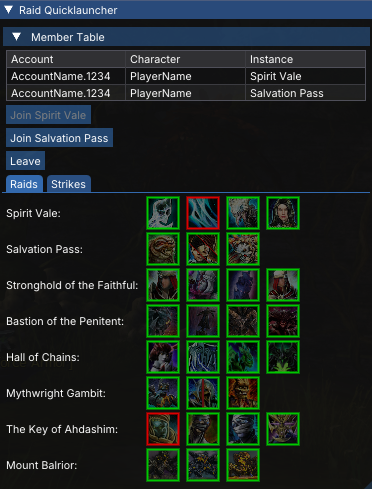
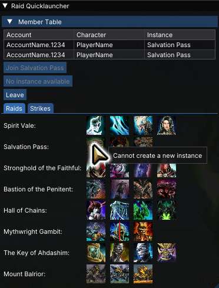
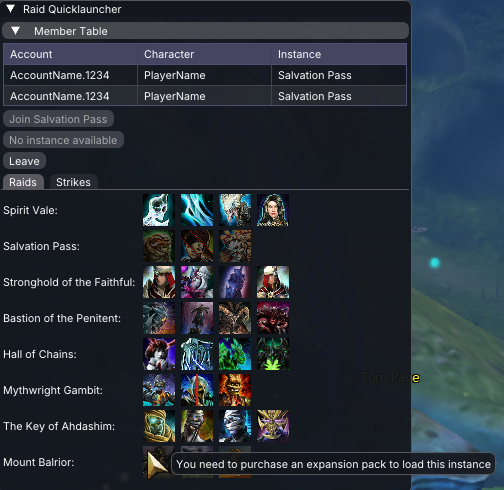
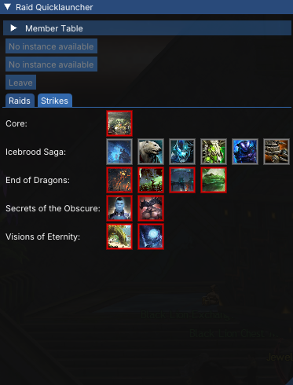

# Raid Quicklauncher

A [Nexus](https://github.com/RaidcoreGG/Nexus) addon for Guild Wars 2 that lets you start or join a raid or strike with a single click.

Raid Quicklauncher is a compact UI for one-click joining or creating raid or strike instances.

## Features

- **One-click instance creation**: each strike instance and raid checkpoint has their own icon for creating an instance.
- **Join existing instances**: shows a join button for each instance your squad occupies.
- **Squad member table**: lists each player in the squad and their current instance.
- **Completion tracking**: optionally color encounter buttons by its completion status.

## Requirements

[Nexus](https://github.com/RaidcoreGG/Nexus) addon loader.

## Installation

Download from releases and place in your Guild Wars 2 `addons` directory.

## Usage

- You must be on a level 80 character and in a Raid Squad to view the available instances.
- You must have the pre-requisite expansion packs to access the raids or strikes; entry will be disabled otherwise.
- The usual rules for raid instances apply: you cannot have more than 2 raid instances open at the same time, and you 
  cannot open more than one of the same instance (even at different checkpoints).

## Screenshots

## How it works

Raid Quicklauncher instructs the game client to do the same thing as what happens when you click "Enter" on the raid 
panel.
