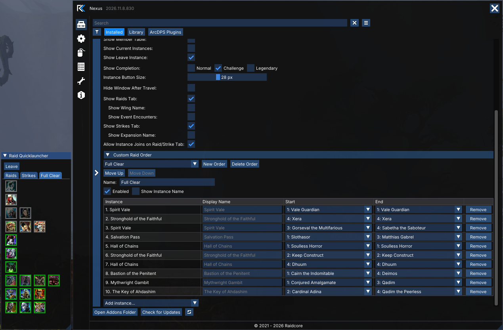
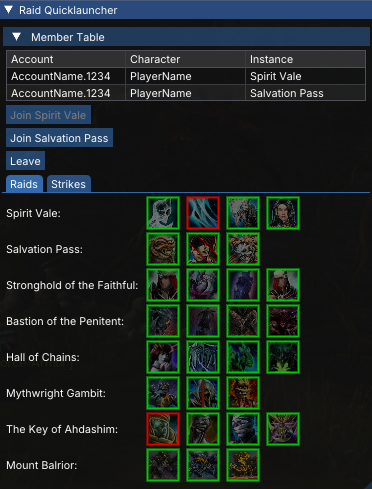
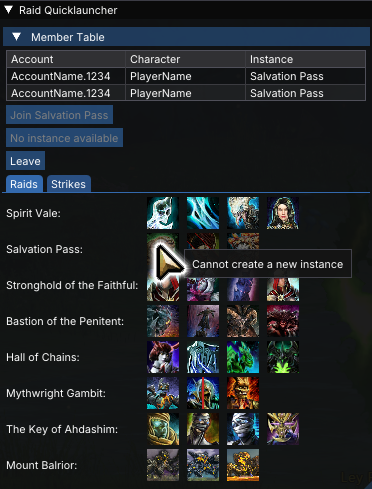
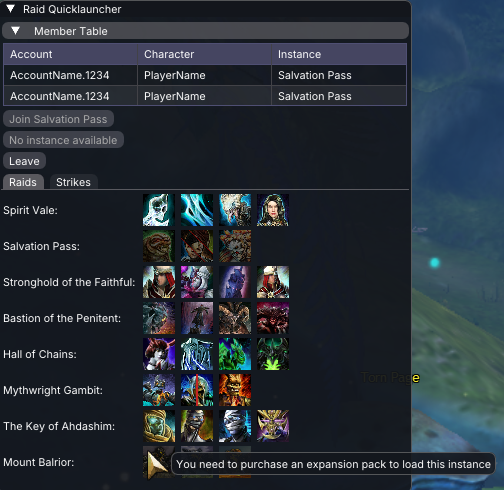
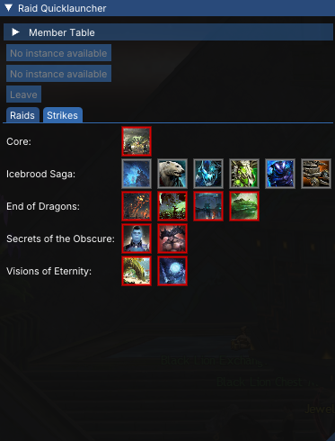

# Raid Quicklauncher

A [Nexus](https://github.com/RaidcoreGG/Nexus) addon for Guild Wars 2 that lets you start or join a raid or strike with a single click.

Raid Quicklauncher is a compact UI for one-click joining or creating raid or strike instances.

## Features

- **One-click instance creation**: each strike instance and raid checkpoint has their own icon for creating an instance.
- **Join existing instances**: shows a join button for each instance your squad occupies.
- **Squad member table**: lists each player in the squad and their current instance.
- **Completion tracking**: optionally color encounter buttons by its completion status.

## Requirements

[Nexus](https://github.com/RaidcoreGG/Nexus) addon loader.

## Installation

Download from releases and place in your Guild Wars 2 `addons` directory.

## Usage

- You must be on a level 80 character and in a Raid Squad to view the available instances.
- You must have the pre-requisite expansion packs to access the raids or strikes; entry will be disabled otherwise.
- The usual rules for raid instances apply: you cannot have more than 2 raid instances open at the same time, and you 
  cannot open more than one of the same instance (even at different checkpoints).

## Icons

The icons used are downloaded from this repo and stored in `addons/RaidQuicklauncher/icons/`.  If you wish to use a 
different icon for a particular encounter, just replace the file with the same name.  All icons will be rendered as 
squares.

## Custom Raid Clear Orders

In the addon configuration, you can create a custom list of instances unique to your raid groups clear order.  From 
this list, you can immediately click on the next instance in your list once you are done with the current one.

## Disclaimer: Be careful about leaving too quickly without getting rewards.

In my experience, in combination with a cutscene skipping addon, CM rewards for Dhuum, Qadim, and Qadim the Peerless 
(each have a cutscene at the end)
are received up to a few seconds after going out of combat, so it is possible to go to your next instance without
receiving full rewards.  You can toggle on the border indicator to see that you were credited with success before
moving on.

## Screenshots

## How it works

Raid Quicklauncher instructs the game client to do the same thing as what happens when you click "Enter" on the raid 
panel.
